# 线性代数基础 · 一捆数与一张表

我们依旧从老生常谈的一般规律说起。一个系统的发展，是内外因不断作用变化的结果；我们何以知道一个系统接下来如何发展，在前几篇文章里已经讲过——知道变化的变化的变化，就能推知接下来的发展，这也是泰勒展开得以存在的基础。而这个系列走到这里，数学工具已经备了不少：变量与函数、微分方程、复数与复变函数、拉氏变换，一直到上一篇文章的相空间与功率谱密度。

但有一笔账，我们欠着。

上一篇文章讲相空间的时候，说悬挂系统的两个状态变量可以作坐标轴，紧接着写了一句“可以写成矩阵形式”，然后就没有然后了。一坨排成两行两列的数，凭什么就能代表一个系统的发展规律？在之前的文章里，规律从来不是这个样子的：规律是变化决定变化，是位移决定加速度（上一篇文章里那个反例），是变化率的变化率的变化，统统是变化与变化之间的关系。一坨数不会变化，它怎么“决定”？

要还这笔账，先得回答一个更基本的问题：相空间里的一个点，到底是什么。

上一篇文章说，位移和速度两个变量，一个在横坐标一个在纵坐标，每一个点都代表系统的一个状态。这话是对的，但它只说了一半。我们顺着这句话往下看：平面上的这个点，从来不是孤零零的一个点——它是两个数并排放在一起。可两个数并排放，就只是两个数吗？在《复数与复变函数》那一篇里我们早就见过另一种读法：两个数并排放，就是从原点出发的一支箭头，一个数管方向与长短里的方向，另一个数管长短。复平面上的 2+1i 是如此，相平面上的 (y, v) 也是如此——它从来都是一支箭头，只是上一篇文章里我们叫它点，没叫它箭头。

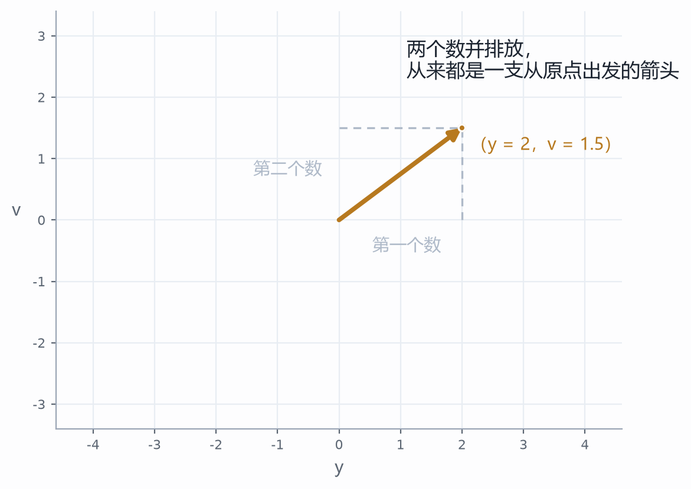

现在把这支箭头当成一个东西看，而不是两个数看。第一件能做的事是并起来：两支箭头首尾相接，得到第三支，这就是两捆并成一捆，写成 $u+v$；日常里这件事我们天天做——往东走一段、再往北走一段，等于直接斜着走一段，两段位移接起来就是一段位移。第二件事是整捆放大缩小：整捆按比例抻长、压短，写成 $2v$、$\tfrac12 v$，连同反向——反向不过是按负的比例放大，写成 $-v$。《复数与复变函数》里实数与复数统一的加减法则，在这里原样成立，因为那法则本来就是箭头的法则，不是哪一种数独有的法则。

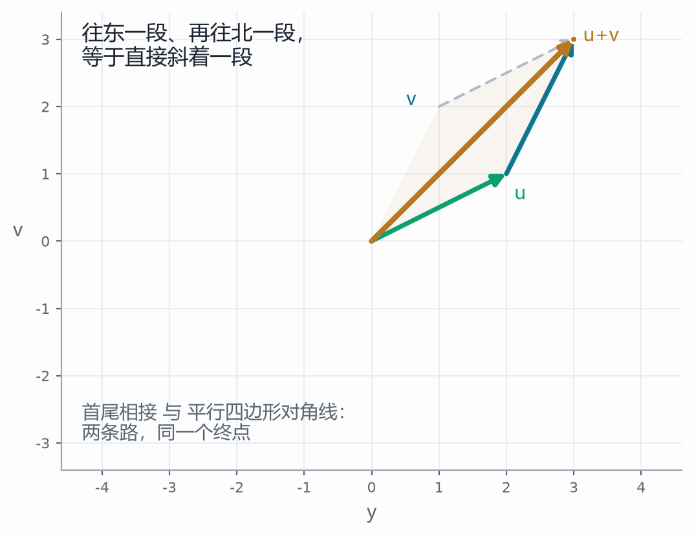

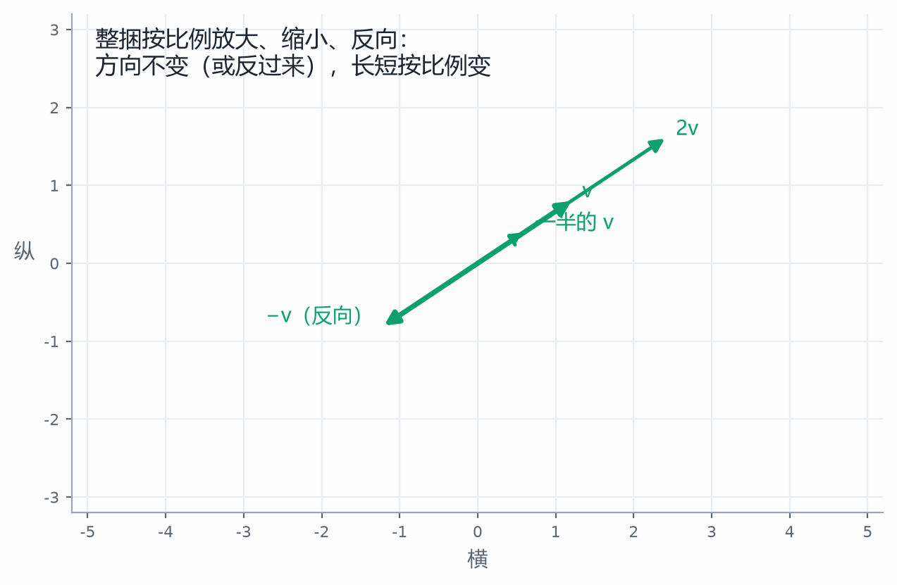

读到这儿大概会有疑问：把两个数捆成一个东西，除了换个说法，有什么用？用处在于，系统的发展从来不分别照顾哪个数。上一篇文章里，相空间的一个点会移动，每个点都有自己的移动方向与快慢，一堆点的移动就是相流——注意，动的是点，是整捆，不是横坐标动了纵坐标没动。规律一作用，整捆数一起动。这就是整体与部分：一捆数不是两个数简单并列，它有了自己的方向、自己的长短、自己的加减；而规律作用在整体上，不分别作用在部分上。以后我们看到任何并排放的几个数——相空间的状态、复数的实部虚部、一组测量值——都先把它看成一捆，再看这一捆怎么被作用。这样的一捆数，数学上有个名字，叫向量。名字现在可以给了，因为这东西已经在我们手里了。

向量这一站做一点就够了：并起来、整捆缩放。下一站看真正的好戏——作用怎么落在这捆数上。

“作用在一捆数上”是什么样，我们其实早就见过。还是《复数与复变函数》：一个复数乘以另一个复数，就是对原来那支箭头施加一个固定的角度变化与模长变化——转个角度、缩个比例，一摁，整支箭头换了位置。比如 (2+i) 乘以 (1+i)，箭头从指向 (2, 1) 变成指向 (1, 3)：方向转了 45°，长短变成原来的 √2 倍。当时我们说这是复数乘法，其实那就是一次作用，只是没写成表。

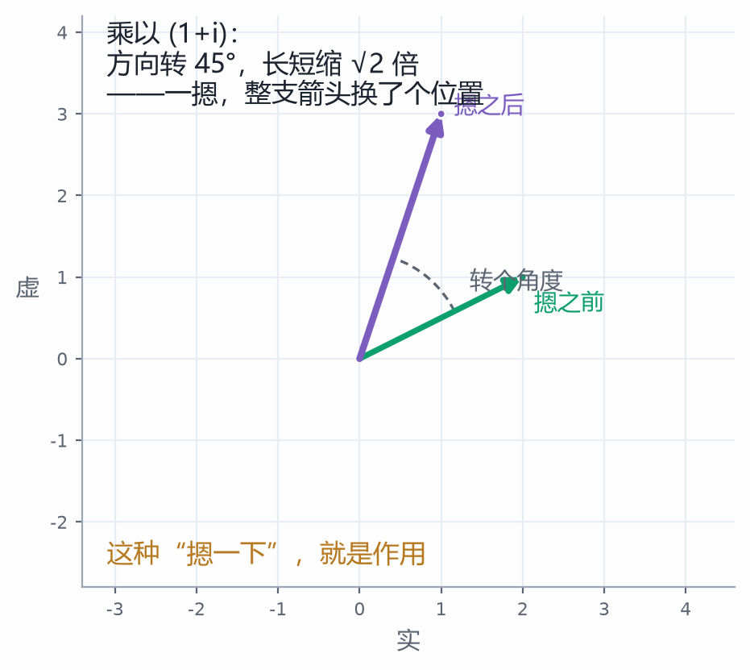

把这种摁法写成四个数，就是一整张表。怎么写成表？盯着平面上的两支底板箭头看：横着的那支被送到了哪里，竖着的那支被送到了哪里——两个去处各两个数，合起来四个数，排成两行两列 $M=\begin{pmatrix} a & b \\ c & d \end{pmatrix}$，就是一张表。表作用在一捆数上，得到另一捆数：横着的数按第一列的法则变，竖着的数按第二列的法则变，再合起来，一件事算清楚就是 $M\cdot u = \begin{pmatrix} a & b \\ c & d \end{pmatrix}\begin{pmatrix} x \\ y \end{pmatrix} = \begin{pmatrix} ax+by \\ cx+dy \end{pmatrix}$。整张表摁在平面上，网格歪的歪、转的转，单位小方块被摁成平行四边形——平行四边形，说明这支箭头与那支箭头被摁后的相对关系变了，但“直线还是直线、平行还是平行”没变，这正是线性作用与非线性作用的分界（第一篇里那条叠加原理的线，在这里露出了几何面目）。

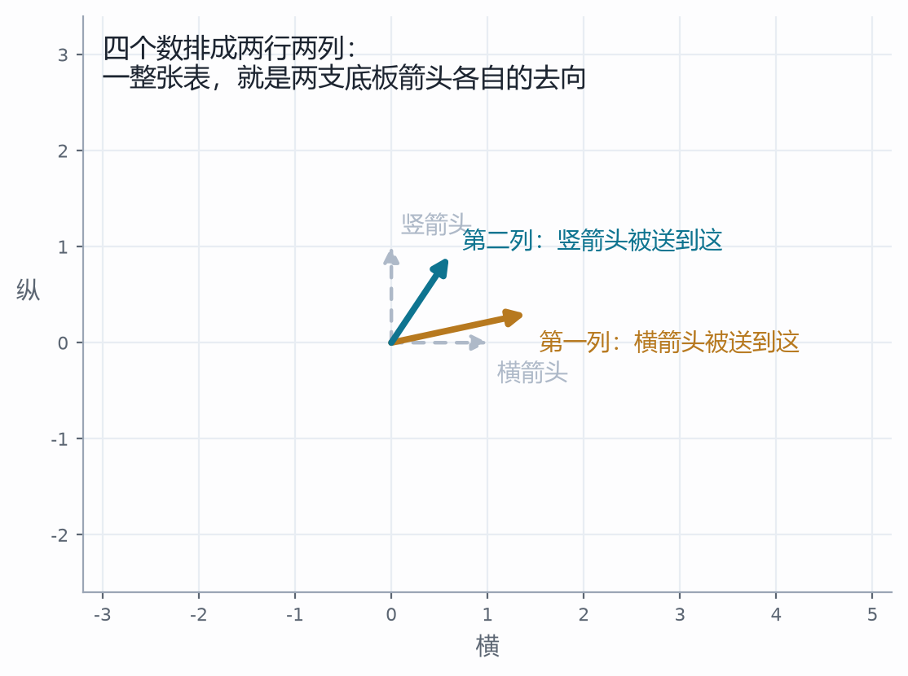

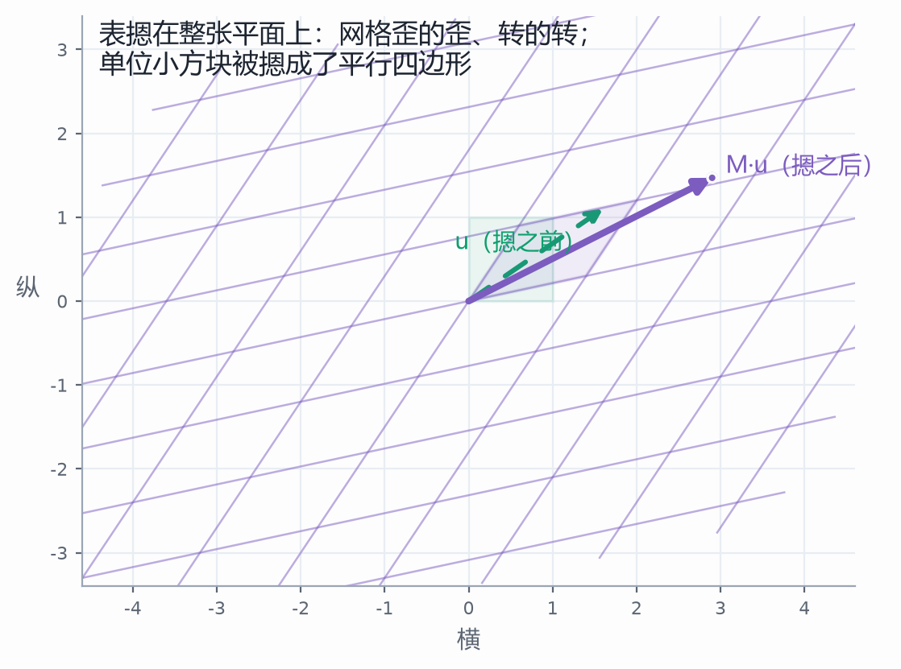

同一件事还能倒过来读，而这一遍更值钱。

刚才把两列读成“两个去处”：横的那根被送到哪儿、竖的那根被送到哪儿。换个读法：**这两列就是新的两根尺子**——第一列是新的横，第二列是新的竖。底板没动，尺子换了。

两种读法算的是同一道题。拿 $A=\begin{pmatrix}2&1\\1&2\end{pmatrix}$ 试：一捆数 $\begin{pmatrix}1\\1\end{pmatrix}$ 的意思是“1 个横 ＋ 1 个竖”。按“尺子换了”读，那个“1 个 ＋ 1 个”的构成一个字不改，只是横换成 A 的第一列 (2,1)、竖换成第二列 (1,2)——结果就是 1 个 (2,1) 加 1 个 (1,2)，等于 (3,3)。按“点被送走”读，算的是同一件事：$A\cdot(1,1)=(3,3)$。一分不差。

差别只在**谁在动**：前一种读法里，点在动、尺子不动；后一种里，尺子动了、点在尺子上的读数没动。什么时候必须用后一种？当你关心的不是“它跑到哪儿”，而是“同一支箭头换一套尺子量，读数是几”的时候。

乘法那句口诀，在后一种读法里才有理由：结果的第 i 个分量，就是拿新尺子的第 i 个坐标，去数旧的那两组分量——“左边横的数分别乘右边竖的数”，不是要背的规矩，是换完尺子重新数一遍。

这一步动的不是点，是点脚下的尺子。往后看，它的分量会越来越重：两张表相乘的时候，动的是对方那把尺子。

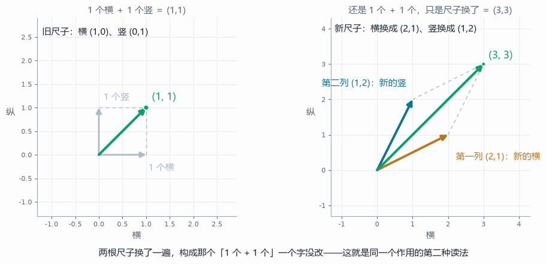

现在可以还上一篇文章欠的那笔账了。悬挂系统的规律是位移决定速度、速度决定加速度（第 10 篇那个反例的正式说法），写成相空间的语言：一捆数 (y, v) 进来，被规律作用一次，出去一捆数 (y′, v′)，其中 y′ 就是 v，v′ 由位移与速度按牛顿力学决定。一捆进去、一捆出来——中间那个作用，就是一张表，而表里的四个数，被 m、k、c 这三个内因参数彻底决定。上一篇文章那句“可以写成矩阵形式”，写全了就是这样：

$$ \begin{pmatrix} y' \\ v' \end{pmatrix} = \begin{pmatrix} 0 & 1 \\ -k/m & -c/m \end{pmatrix} \begin{pmatrix} y \\ v \end{pmatrix} $$

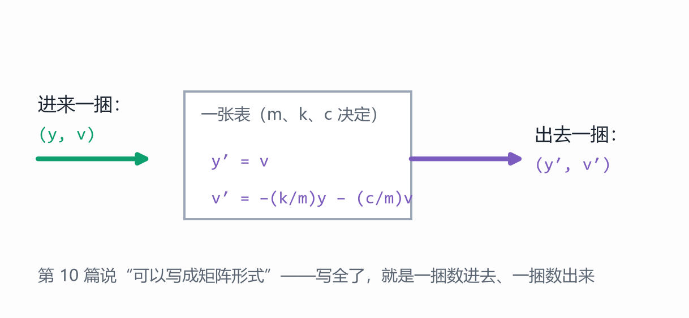

所以矩阵凭什么能代表规律？凭的就是：规律作用在一捆数上，而一张表把“任何一捆数进来、哪一捆数出去”整个记了下来。一坨数不会变化，但它记下了变化本身——这跟函数是一个道理，函数也不过是一个记号，记下的却是变量之间的关系。这样的一张表，就是矩阵；矩阵作用在向量上，就是这一站的全部。

下一站看两张表连着摁。两张表连着摁，合起来还是一张表——先摁第一张、再摁第二张，任何一捆数连吃两下，等价于吃一张合起来的表，这就是表相乘，写作 A·B（先摁 B，再摁 A）。意外就在这儿：换个先后，合起来的表往往就变了。拿“转 90°”和“横方向抻 1.6 倍”试：先抻后转，一捆数 (1.3, 0.9) 的终点是一个位置；先转后抻，同样这捆数，终点跑到另一个位置去了。

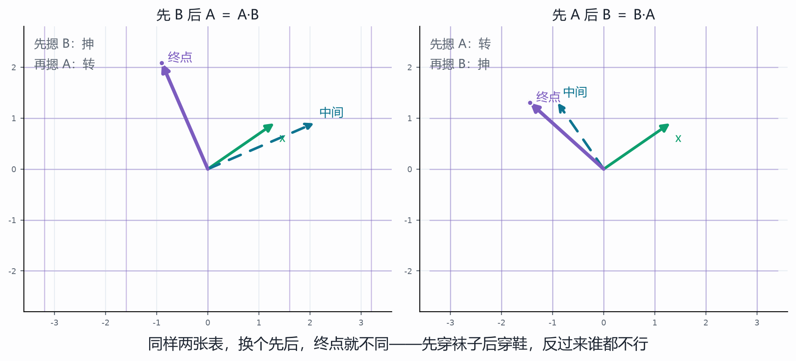

日常里这件事我们熟得很：先穿袜子、后穿鞋，人才出得了门；颠倒过来，先穿鞋再穿袜子，谁都做不到。两件事有先后，合起来的结果就不同——表也是这样，顺序也是内容的一部分。算法上怎么算合表？一列一列看：合表的第一列，就是被先摁的那张表的第一列、再被摁一次的结果；第二列同理。算法的口诀爱怎么记怎么记，但别把口诀当意义——意义是“先后两次作用”，不是“行点列”。

那句“一列一列看”，藏着一个前提，值得当场指出来。

合表的第一列，是先摁的那张表的第一列“再被摁一次”。被摁的是**那一列本身**——而它之所以能被摁，是因为它被写成了两个数，这两个数是按横竖那两根标准尺子读出来的。所以 A 作用 B，作用的是 B 的两列这两捆数，不是 B 所代表的那两根新轴。B 的两列一旦被当成箭头看，它们就已经站在标准尺子上了。

同一根东西在两句话里换了身份：在“尺子换了”那句里，B 的两列是尺子；在“A 作用 B”这句里，B 的两列是待摁的箭头。换身份不换内容，但读的时候得清楚自己在哪一句里——**这一问不答，合表就会被读成“A 又把 B 的新轴换了一遍”**；实际发生的是：A 把 B 的两捆数送到了别处，这两捆数的新位置，成了合表的两根新尺子。

每张表内部都默认着那副标准尺子。这个默认平时看不见，只有另一张表来作用它的时候才露面。

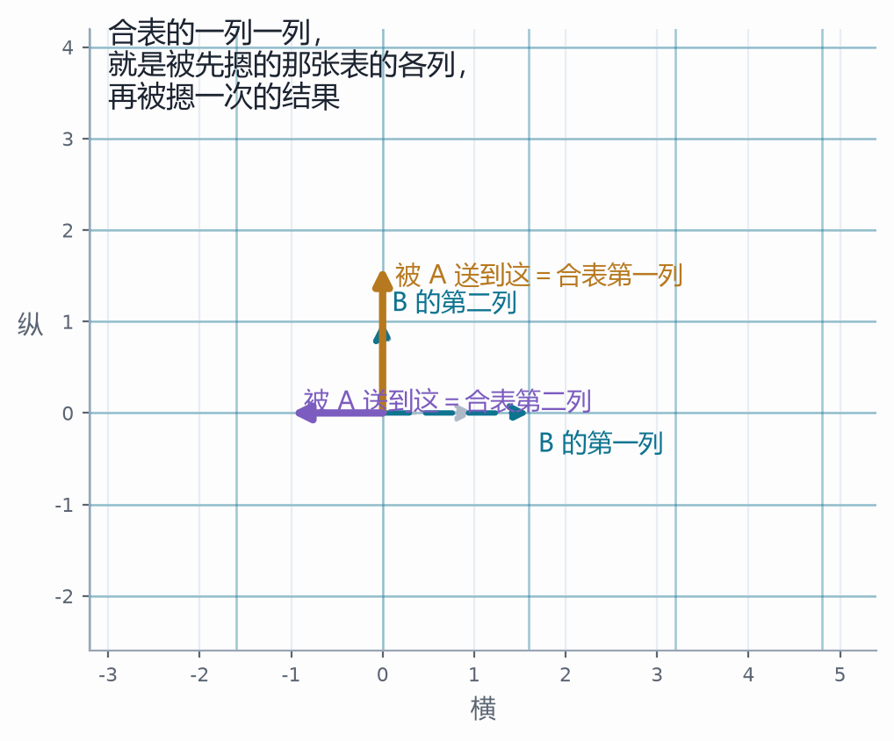

也要说清楚这句话的边界：不是永远不一样。如果两张表都只是各自方向上的伸缩，谁也不挡谁的路，先后就无所谓了——这就是可交换的反例。可见“顺序有别”不是铁律，是常态里的意外；真要什么时候都一样，那才是要专门记住的特殊情形。

第四站是这一篇最要紧的一站。盯着被摁弯的网格看：绝大多数方向都被拧转了，可总有例外——有几个方向，箭头被拉长或者压短，方向却一点儿没变。变了的是长短，没变的是方向，变与不变的矛盾在这个画面上直接摆在眼前。

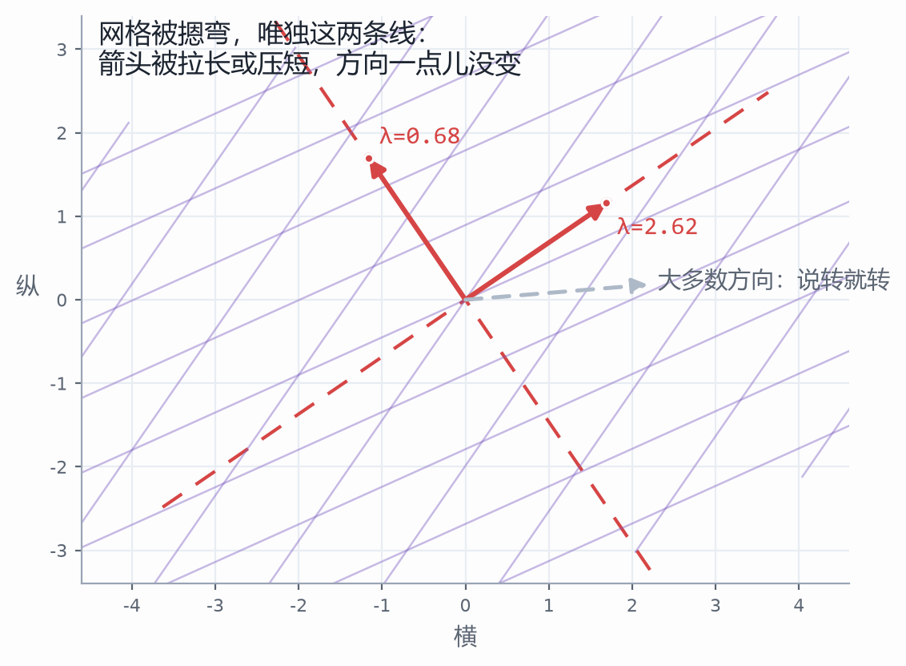

把这件事说成一句可以自己复述的话：沿着某些方向，作用只是让长短变。写成式子，就是作用之后还跟原来共线、只差一个倍数：$Mv = \lambda v$——v 是那一捆数，λ 是长短变的倍数。这样的方向，叫做这张表的特征方向；λ 叫做特征值（名字又是后置的，话先说清了才给牌）。找到特征方向有什么用？用处大到离谱：一张表再复杂，沿着特征方向看，它只是几个简单的伸缩；一捆数沿着特征方向的分解，往往就把一团乱麻的运动拆成了几件各自独立、彼此不相干的事。这正是 01 篇那条“线性关系适应叠加原理”的深层面目——各自独立，才能叠加。

把这话立刻用到弹簧系统上。无阻尼时，相空间里的运动是一个椭圆，$\lambda=\pm 2i$——没有一条不转的方向，可这椭圆我们也不是第一次见：它就是《欧拉公式与拉氏变换》里那个转圈的矢量，边转、不缩（无阻尼，转圈就是全部）。加了阻尼，相图变成一圈圈螺旋，$\lambda=-0.2\pm 1.99i$：实部是负数，意思是每单位时间整体缩掉 $e^{-0.2t}$——边转边缩，转圈的是老朋友，缩放也是老朋友（拉氏变换里那个衰减系数）。复数乘法就是旋转加放缩，这句话在 04 篇是结论，在这里成了读相图的眼镜。

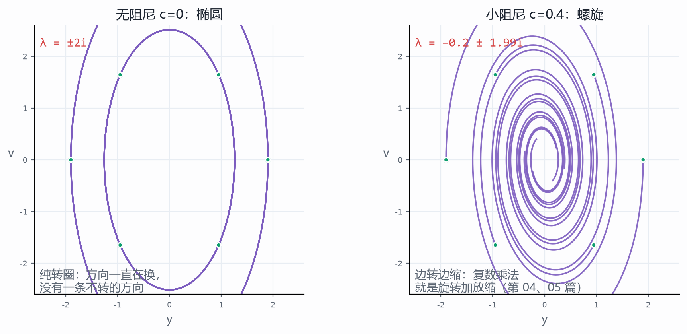

再看一个质变的现场。把阻尼 c 从 0 开始一点点连续增大：c 小的时候，特征方向是复的，一条不转的方向都没有；c 增大到临界值 $c = 2\sqrt{mk}$ 那一刻，复方向变成两条实方向——一快一慢，都指着原点；c 再大，相图从螺旋变成“先冲一把、再慢慢爬回去”。c 的变化是连续的、一点点积累的，可“有没有不转的方向”这件事在临界值上突然换了性质：从没有，到有两条。这就是 06 篇讲的量变到质变——奇点不是别的东西，就是质变发生的那个点，这里它有一个可以够得着的名字：临界阻尼。在项目里把 c 的滑条从 0 推到 6，亲手把这个点摸一遍，比读十遍定义都牢。

第五站看面积。一张表摁下去，一块面积的放大倍数是多少？答案是一个数：作用后平行四边形的面积，除以作用前的面积，$\dfrac{S(\text{像})}{S(\text{原})}$。对一张表来说它有个干净的算法，$\det M = ad-bc$，这个数有名字，叫行列式。把它连续调小：面积连续变小，这是量变；调到 0 的那一刻，整个平面塌成一条线——这是质变。06 篇说奇点是量变到质变的点，行列式等于 0 就是平面上最干脆的一次质变：二维的系统塌成一维，信息被摁扁，从此反不回去（下一站就讲这个）。还有个细节：放大倍数是负的，不是说面积是负的，是说朝向被翻了面——小旗从顺变逆，像照镜子。倍数取绝对值，朝向另说。

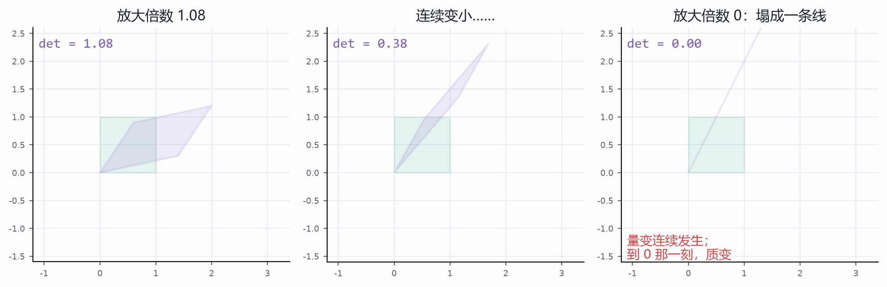

第六站讲反作用。知道秤上的重量，反推原来有几箱货——已知作用的结果，反推作用的原因，这就是解方程 $Mx=b$：b 是结果，x 是原因。只要没被摁扁（行列式不是 0），原因就唯一，反推得回去，写成 $x=M^{-1}b$；摁扁了呢？反推不回去——不是没有原因，是原因有一整条：平面塌成的那条线上，每一捆数都被摁成了同一个 b。作用与反作用本来是一对（07 篇），可反作用能不能成立，全看作用那边有没有把信息摁扁。

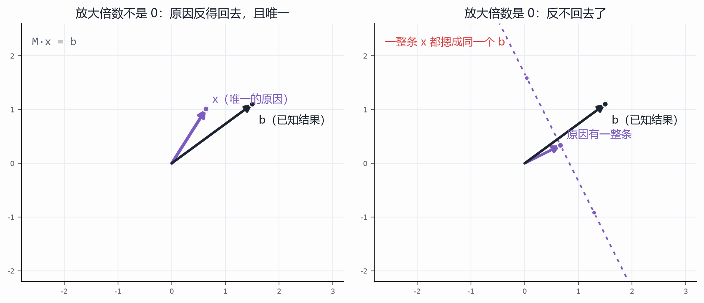

到这里，一捆数的一生就走完了：两个数并排放，是一捆；一捆被一张表作用；两张表连着摁有先后；被摁弯的网格里有变了又没变的方向；作用把面积放大或摁扁；知道结果还能反推原因。收在这张图上：

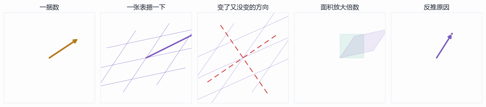

带走三问，比带走名词有用。以后见到任何一捆数，先问：它是怎么被作用的？——找到那张表。再问：哪些方向变了又没变？——找到特征方向，运动再乱也能拆成几件独立的事。最后问：这作用把面积放大还是摁扁？——放大倍数是不是 0，决定这结果反不反得回去。三问问完，一个系统的内因（那张表、表的参数）就摸到大半了。

然后是动手。内因上，改那张表——弹簧系统里就是改 m、k、c，改结构、改阻尼，特征方向与面积放大倍数随之改变，系统的脾气就变了；外因上，换一捆数进去试——换初始状态、换输入那一捆，同一张表、不同外因，走出去的路不同。内因外因都动，才是完整地作用于一个系统，这也和上一篇文章落点在结构、在路面上是一个路子。

深水区照例挖坑，留给番外篇：特征方程怎么解、λ 怎么算出来（$\lambda^2-\mathrm{tr}\cdot\lambda+\det=0$ 摆在这儿，求解留到下一篇）；任意一张表能不能拆成“转圈”加“缩放”的合成，以及为什么相流扫过的面积以 $e^{\mathrm{tr}\cdot t}$ 一路缩小（这与上一篇文章的概率云直接相连）；三维与 n 维怎么想象，向量空间、基与维数、线性相关是怎么回事；逆矩阵与解方程组的成法；以及最大的一个坑——用特征方向去看一个系统“稳定不稳定”，那是控制论的正场，我们还一次没进去过。坑都在这儿，一篇一篇填。

这一篇的图与可交互的部分是配套项目：五个视角——向量工场、矩阵作用台、先后有别、特征方向、行列式与反作用——都在本目录的“项目”文件夹里，双击即可打开，全部离线。每个视角都能改条件、看后果，右侧都写着互证与反例；正文里每一张图，都是从项目的同一套数学里算出来的。读到哪儿手痒，就去把那个滑条拉到那儿——比如把 c 推过临界阻尼，把放大倍数摁到 0，把红线上的一个点拖出来看它被摁到哪。外因终究要通过内因起作用，而这里的“通过”，就是读者自己上手的那几下。
