# 线性代数基础 · 看不见的状态

上一篇每一次反解，都先写下一支箭头：歪了多少、歪得多快，两个数并排。写起来毫不费力，因为那支箭头是我们自己画的。现在把画笔拿开，换成一只眼睛。

眼睛交上来的不是一支箭头，是一个数。

先别急着问"怎么从这一个数算出那一个"。先看看这一个数到底给了什么。上一篇里我们已经习惯把状态叫"一捆数"：两个数并排，就是平面上的一个点。那么"读数"是什么？读数把这个点压成一个数——它问的是"θ 等于多少"，答完就把 ω 丢掉不管了。于是平面上每一个点，都被贴上一个标签：θ 的值。标签相同的点，连成一条线。

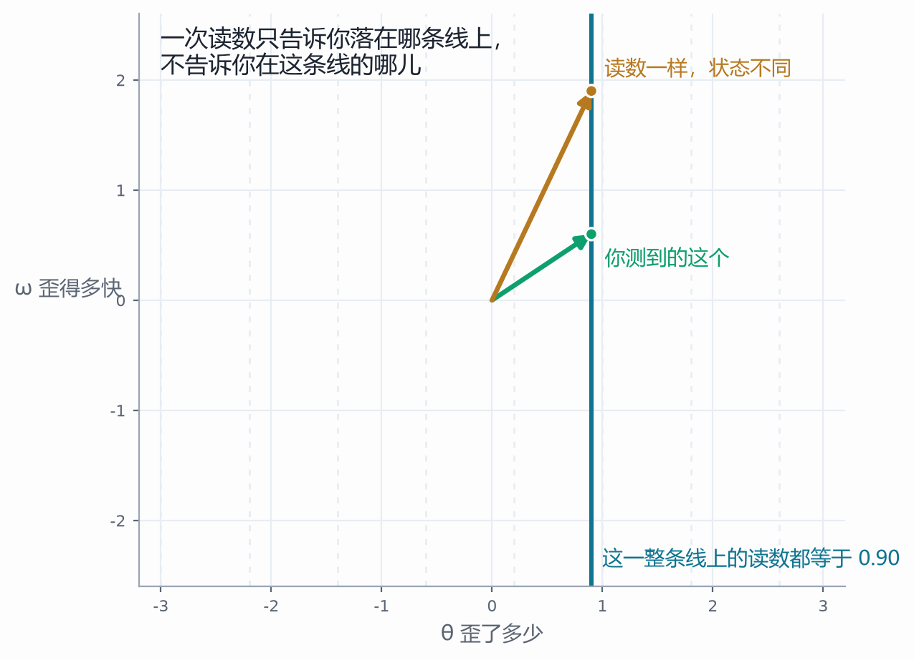

同一个 θ，ω 可以是 0.6，也可以是 1.9。两支箭头一样长地站在那条竖线上，读数一模一样，状态差得远。这不是眼睛不够好——把眼睛换成再贵的仪器，只要它一次只交一个数，这一整条线上的点它就分不出来。**一个数只能定住一维。**

这件事的后果，上一篇已经替我们算好了。手使多大劲，是 k₁ 乘"歪了多少"再加上 k₂ 乘"歪得多快"——两笔里有一笔的原料你没有，这笔力就一定算歪。项目里把两个力并排印着：真值 4.38，按「把看不见的那个当零」算出来 2.70。差那一个数，不是算错了，是有一个数根本没进你的手。

最省事的想法是先冒出来的：歪的多少每时每刻都测得到，那"歪得多快"不就是两次读数相减，再除以中间隔的时间么？这在纸上完全对——导数就是这么定义的。

拿它试一下就知道了。间隔 h 越小，两次读数之间的那段弯曲被忽略得越少；可间隔越小，两次读数各自那点噪声相减之后，也被除以越小的数。**两头夹。**一头随 h 变小而变小，一头随 h 变小而变大。

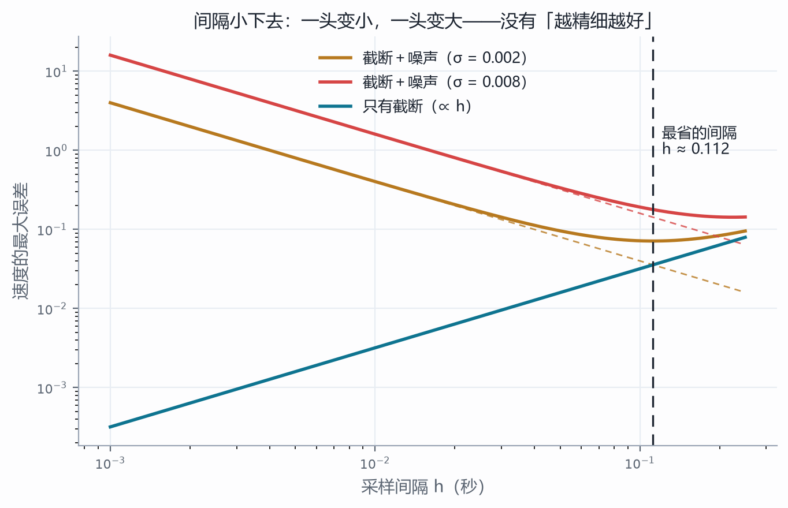

图上有两条东西值得看。一条是那条直线：截断误差按 h 往下走，因为它来自把指数展开到二阶之后扔掉的余项，正比于 h 乘上"角速度的平方再乘 θ"。另一条是那条向上翘的虚线：噪声那一项是 2σ 除以 h，间隔减半它就翻一倍。两条线的和有一个最低点，那个最低点就是这条路上最好的结果——而它并不是"准"，只是"没那么糟"。σ 取 0.002 时最省的间隔在 0.11 秒附近，误差仍有一成左右；把 σ 拖到 0.008、把 h 拖到 0.005，估出来的曲线就成了一团毛刺，比真值本身还大。

所以这条路的结论不是"参数没调好"，是**它在原理上被夹住了**：读数里那点噪声，你没有办法在相减之前把它去掉。

退回去问一句更笨的话。既然我们知道这个系统是什么——那张表、那个 a、那个 c，都是自己写的——为什么不照着它造一个复制品，让它跟着一起跑？

复制品按同一张表走，也吃同样的输入。它唯一的问题是第一刻的初值不可能和真的一模一样。于是要看的只有一件事：**那点初值差，接下来会怎么样。**

先不给它任何纠正，让它自己跑。

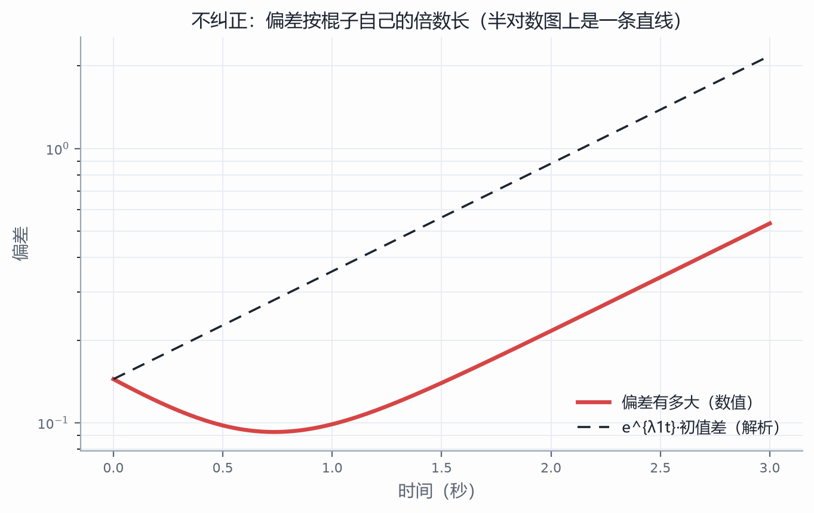

偏差跑掉了。而且跑的方式很干净：把真状态和影子的两条式子相减——同一张表乘同一个状态、同一个输入减同一个输入——**输入没了，常数没了，只剩偏差自己按那张表走**。这件事值得停一下：影子差多少，根本不是"初值差多大"的事，是"这张表怎么样"的事。上一站那两条特征线，就是它全部的去向。

于是半对数图上是一条直线，斜率就是那个正倍数 0.905。每过一秒钟，偏差乘 2.47（e^{0.905}）。

这里要小心一个很容易滑过去的说法："偏差越跑越大，所以复制品不行。"

把滑条拉一拉，这句话就站不住了。把初值差从 0.05 拉到 0.8——大了十六倍——偏差的走势一点没变，只是整条曲线上下平移：**大小只是个放大倍数，它不决定结局。**再换个东西动：把初值差的方向转一转，结局翻过来。转到青线那个方向，偏差自己缩，影子反而追上了。

一个量（初值差的大小）怎么变都不影响结局，另一个量（方向）一动就翻天——这个对比本身就把不变量逼出来了：**决定命运的不是差多少，是差在哪个方向上。**方向只有两条要紧的，就是那张表的两个特征方向。落在红线上那一份按 e^{0.905t} 长，落在青线上那一份按 e^{−1.105t} 缩，两件事同时在发生，谁笑到最后看谁长得快。

真实系统的初值差不会正好落在一条特征方向上，它总是两份都掺着。而只要掺进一点红线成分，前面那个"越跑越大"就回来了。真要把影子拉住，得动手。

动手的办法是上一篇那条线的翻版。真值报一个读数，影子也报一个读数，两个数一减——**这个差是你能拿到的东西**，因为它只用到读数。把这份差乘上两笔系数，补回影子身上：

$$ \hat{x}' = A\hat{x} + bu + L\,(y-\hat{y}), \qquad y=Cx,\quad \hat{y}=C\hat{x} $$

这里的记号要当场说清，因为它正是这一篇最容易读反的地方。$C=(1,0)$ 是**一行**——它把两个数压成一个数，所以它横着写；$L=(l_1,l_2)$ 是**一列**——它是"补回两个数"的那两笔，所以它竖着写。一行乘一列是一个数，一列乘一行是一张表：

$$ LC=\begin{pmatrix} l_1 \\ l_2 \end{pmatrix}\begin{pmatrix} 1 & 0 \end{pmatrix}=\begin{pmatrix} l_1 & 0 \\ l_2 & 0 \end{pmatrix} $$

一张表减一张表，减出来的还是表。而这张表只有第一列不是零——所以这一减，**只改写第一列**。

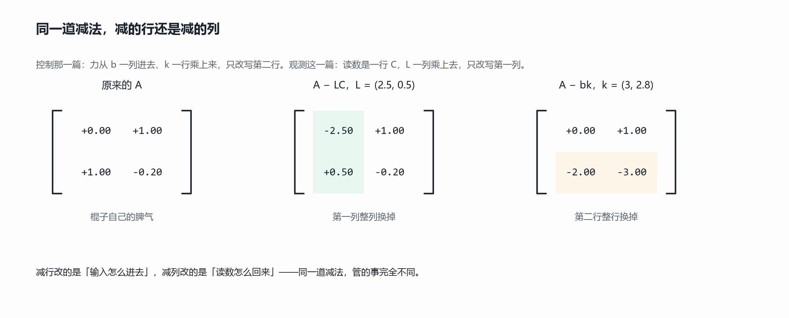

把它和上一篇并排看，差别一下就出来了：控制那一篇里，力从 $b=(0,1)$ 一列进去、$k$ 一行乘上来，改的是**第二行**；观测这一篇里，读数是一行、$L$ 一列乘上去，改的是**第一列**。减行改的是"输入怎么进去"，减列改的是"读数怎么回来"。同一道减法，管的事完全不同——**这就是为什么行与列必须一开始就分清，而不是最后再对答案。**

还有一层：这条读数差是外因，它一接上，就被并进了那张表里——$A$ 变成了 $A-LC$。外因不是从旁边推了它一把，是把自己写进了内因。这一点和上一篇接线时是同一个去向：表相乘、并进内因，于是内因不再是原来那个内因。

新的那张表，两个倍数还是老规矩：对角线相加是 $-(l_1+c)$，交叉相减是 $l_1c+l_2-a$。特征方程

$$ \lambda^2+(l_1+c)\lambda+(l_1c+l_2-a)=0 $$

要偏差自己回来，看两个系数就够了：

$$ l_1+c>0,\qquad l_1c+l_2>a $$

取 $a=1$、$c=0.2$，就是 $l_1>-0.2$、$l_2>1-0.2l_1$。两条都是直线，所以"能不能追回来"在 $l_1$、$l_2$ 平面上是一片有边界的区域。

要给一个具体的答案，取 $L=(5,5)$：两个倍数成了 −1.27 与 −3.93，都在左半边；同一份初值差，四组力度跑出来的偏差曲线长这样——

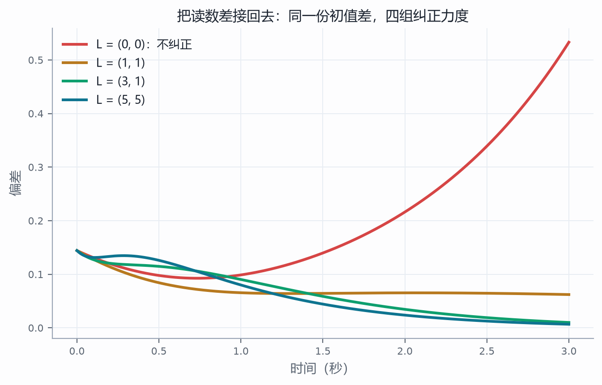

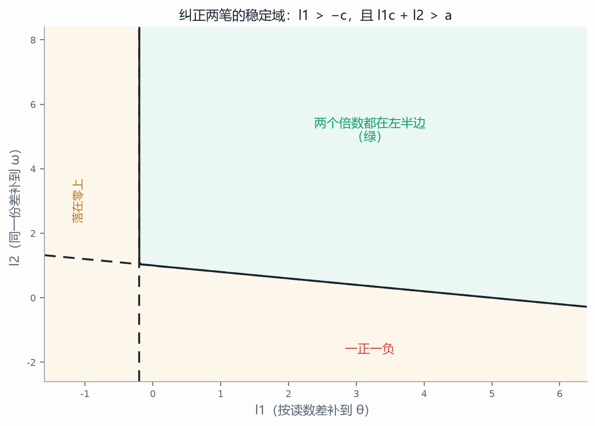

看图先别急着读数。横轴是"按读数差补多少到 θ"，纵轴是"同一份差再分多少到 ω"。着色只说明一件事：右上方那一片，两个倍数都在左半边。两条边界各有一句话：竖着那条是"和为零"，斜着那条是"积为零"。**跑出去有两种跑法**，一种是一正一负（积为负），一种是两个一起正（和为正）——这跟上一篇闭环那张表的两句话是同构的，只是参数换了个位置。

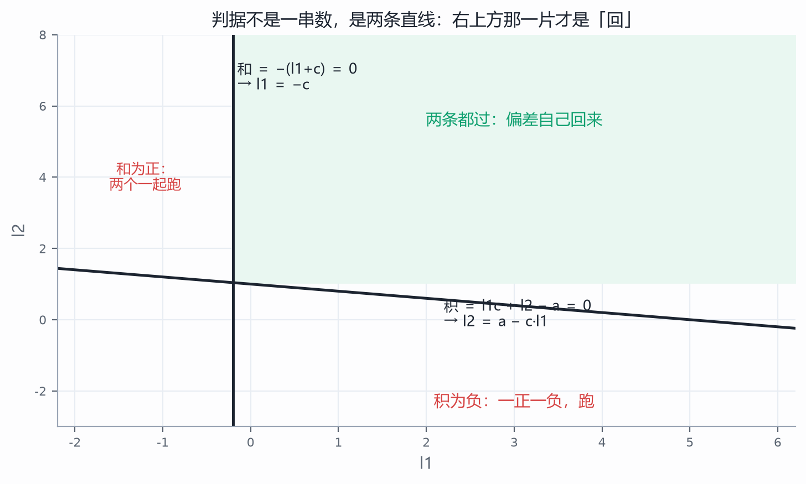

判据可以这么推，也可以直接对表算。项目里两件事并排印着：一边拿上面那两条不等式，一边把 $A-LC$ 的四个数代进特征方程解根，两边的数一模一样。

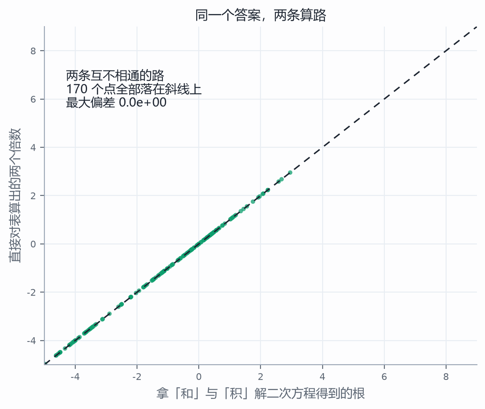

这张散点图是一百多次随机取值画出来的：横轴是用"和"与"积"解出来的根，纵轴是直接对表算出来的两个倍数。每一个点都落在斜线上——两条互不相通的路给出同一批数。这类图在上一篇也出现过一次，用处不是好看，是让人不能只信一条。

既然两个倍数是被"和"与"积"定住的，那就可以反过来：**先说我要它们落在哪儿，再解出该补多少。**这和上一篇把力反解出来是同一件事，只不过这次搬的是偏差的倍数。

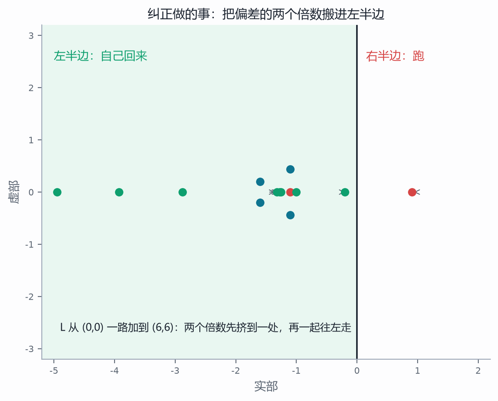

横轴是实部，左半边是自己回来的那一半。$L$ 从 $(0,0)$ 一路加到 $(6,6)$，两个倍数先在右半边挤到一处（那是 $(1,1)$ 附近，一对共轭复数），然后一起往左走。落在右半边的，偏差越跑越大；落在左半边的，影子追上真身。

有一处边界要说清：$l_1$ 拖到 $-0.2$ 的时候，"和"正好是零，两个倍数里有一个落在零上——它既不肯回来，也不跑掉，影子就停在半路的某个偏差上。这不是"力度差一点"，是**恰好卡在分界线上**。往左一寸，它就跑；往右一寸，它就回。

前面每一站都默认了一件事：读数取的是 θ。可"取 θ"只是一个选择。眼睛可以量别的——比如量 θ 和 ω 的一个混合。这一站把测的方向拧一拧。

读数 $y=c_1\theta+c_2\omega$ 是把这个点投影到某个方向上：标签相同的点连成一条条平行线，**读数只告诉你落在哪条线上**。方向一转，这族线跟着转。

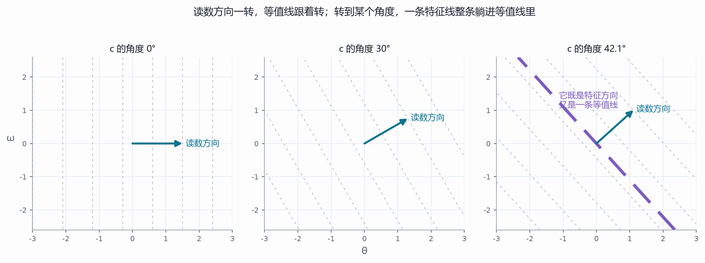

第一幅：测 θ，等值线是竖的。第二幅：测 θ 与 ω 的混合，等值线斜过去。第三幅：转到 42.1°，出现了一件怪事——有一条特征线整条躺在一条等值线里。

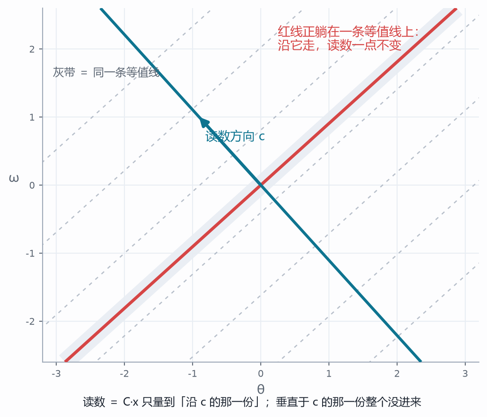

躺进去意味着什么？沿着它走，读数一点不变。于是这条方向上的任何运动，读数都看不见；你看不见，就无从纠正。写成式子是这样：如果一条特征方向 $v$ 满足 $Cv=0$，那么

$$ (A-LC)v=Av-L(Cv)=\lambda v $$

对**任何** $L$ 都成立。那个倍数 λ 钉死在原地，$L$ 拖到多大都没用。

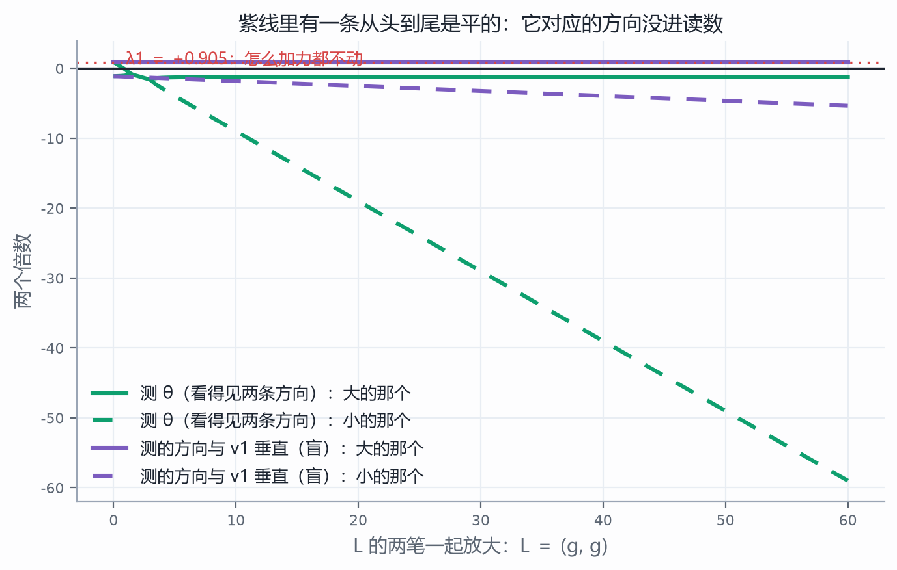

图上两组曲线：一组是测 θ（两个倍数都在动），一组是测的方向与那条特征线垂直（有一个从头到尾是平的，就是 +0.905）。把力度从 0 开到 60——比另一组大二十倍——那条平线一点没抬起来。

**看得清不清，本身也有一个判据。**把"这一刻读什么"和"它下一刻读什么"摞成两行，交叉相减：

$$ O=\begin{pmatrix} C \\ CA \end{pmatrix},\qquad \det O=c_1^2-c\,c_1c_2-a\,c_2^2 $$

不为零，两个方向都进得来；等于零，就有一条永远看不见。而这个式子什么时候为零？把 $c_1=-\lambda c_2$ 代进去就服了——**零点恰好在两个倍数的相反数上**。

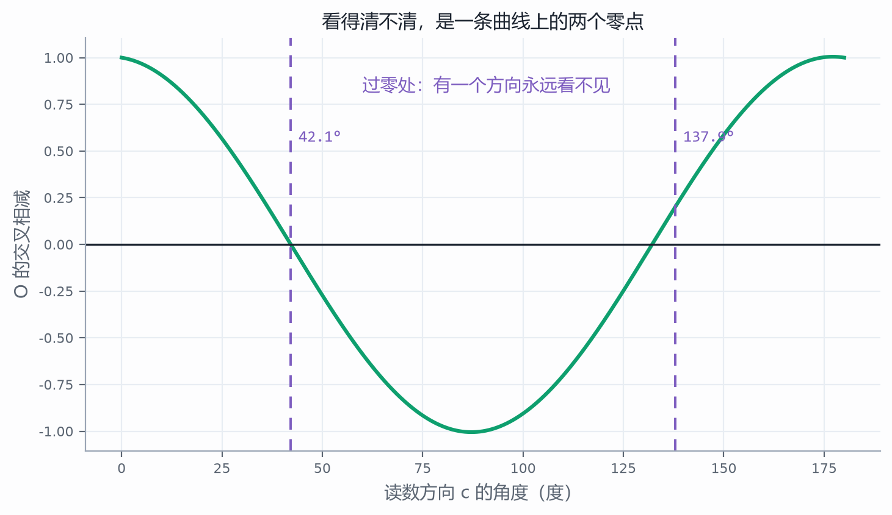

角度从 0 扫到 180，这条曲线过零两次：42.1° 和 132.1°。转过这两个点，判据翻个面。

到这里，上一篇那个"两处塌缩"的结构又出现了一次，而且这次是从同一个比喻里推出来的，不是另找的例子：**看不见的那条方向，可能是"回来的"那条，也可能是"跑掉的"那条。**

- 42.1° 时，藏在影子里的是 −1.105 那个倍数——它本来就会自己回来。另一个（+0.905）还能被 $L$ 搬动，所以影子**追得上**：看不见的那一份不用管，看得见的那一份管得住。
- 132.1° 时，藏在影子里的是 +0.905——那个跑掉的。它钉死在原地，无论你补多少，偏差里只要有这一份，它迟早把影子甩掉。这一种**没救**。

同一个交叉相减为零，一个还有救、一个彻底没救，差别只在被藏起来的那条方向本来是正是负。这和上一篇"b 落在红线上还救得回来、落在青线上就没救"是同一句话，换了个位置说。

把四种测法摆在一起看：

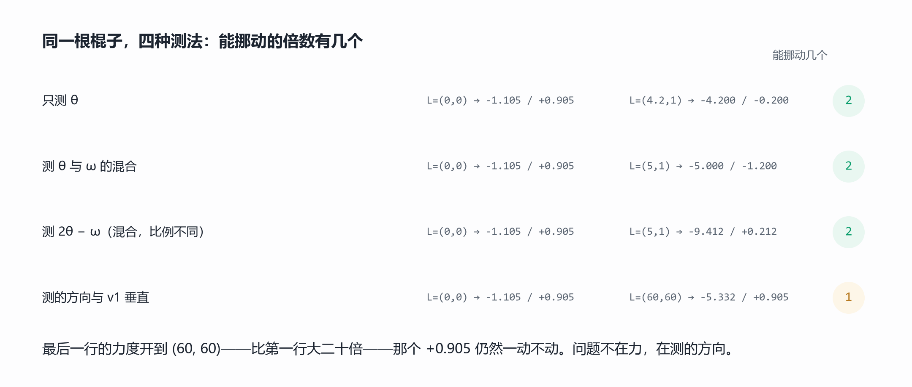

只测 θ、测一个混合、测另一个比例的混合，只要那个交叉相减不为零，两笔总有办法把两个倍数都挪进左半边。转到那个角度，力度开到六十倍，那个 +0.905 一动不动。

所以这一篇真正落下来的动作，不是"把 $l_1$、$l_2$ 调多少"，而是更靠前的一步：**换一个测得到的东西。**传感器的位置、测哪一个量、要不要再加一路读数——这些是改 $C$ 的事；$L$ 只是在给定的 $C$ 上把能做的做到头。$C$ 选错了，$L$ 调到天上去也是白搭。这在工程上有个朴素的说法：装传感器的时候花的钱，比调参数的时候省的心值钱。

这个落点也说不出什么。观测器给你的，是"在模型正确的前提下，最好的猜测"——它不是测量，是**算出来的替身**。模型错的时候，影子照样跟着错，而且还错得很自信：偏差会收敛到某个非零的地方，收敛得越漂亮越像真的。它不会告诉你模型哪一项写错了，也不会告诉你哪个参数该重新量。那是另一件事，名字叫辨识，这一篇一个字也没碰。

接着上一篇的三问往下走。上一篇问：回来还是跑掉？跑掉的那个方向够得着吗？够得着的话要它落在哪儿？这一篇问的是同一件事的另一面：

**我手里的读数，能定住几个数？**——一个数定住一维，其余的全在一条线上。

**看不见的那一份，凭什么会被追回来？**——看偏差的两个倍数在不在左半边；判据是两条直线。

**哪一份根本追不回来？**——看读数方向与特征方向垂不垂直。垂上了，那个倍数钉死，力度再大也没用。

三问问完，"稳不稳"这件事就从一个数的问题，变成了两个数、一个方向、一处退化的几何问题。而最开始那个"一个数定不住两个数"，到这里有了一个不算安慰的安慰：**定不住，但可以追**——只要追的那条路不被自己堵死。

深水区照例挖坑。三个：那条"看不见的方向"一旦有两个以上，判据还管不管用（多个状态时，交叉相减要换成一张更大矩阵的行列式，够不够看得清要看它的秩）；真实读数不只是噪声小，还可能**慢半拍**——传感器有延迟，那时候这个影子还能不能追上，是另一套算法；还有最初那条被放弃的路：差分的噪声放大，工程上不是没办法，是先"滤"再"差"，滤什么、滤掉多少，那又是频谱那一套东西。最要紧的那个坑还在原地：这一篇从头到尾用的都是"只歪一点点"的那张表。棍子真歪到三十度，这些 0.905 和 −1.105 全都不作数了。非线性是另一篇文章的事，我们欠它两次了。

这一篇的图与可交互的部分是配套项目，在本目录的"观测项目"文件夹里，双击即可打开，全部离线。五个视角——只看见一个数、差分这条路、让影子跟着跑、纠正减在第一列、影子里那条线——每一站都能改条件、看后果，右侧都写着互证与反例；正文里每一张图，都是从项目的同一套数学里算出来的。读到哪儿手痒，就去把那个滑条拉到那儿：把噪声拖到 0.008、把间隔拖到 0.005，看差分怎么变成一团毛刺；把初值差的方向转到 312.1°，看偏差怎么自己缩回去；把测的方向拖到 132.1°，看那个 +0.905 怎么在 60 倍的力度下纹丝不动。看不见的东西不是不存在，它只是没落在你量的那一束光里。而这一篇里，读者自己上手拧的那几下，就是把光束挪开的那几下。
