# 线性代数基础 · 让会倒的东西站住

上一篇收在了一个动作上：想让一个系统换个脾气，就去改它的参数。这个动作在那儿是有底气的——表里那几个数全由参数决定，改参数就是改表，改表就是改两个倍数。弹簧系统里试一遍更顺当：阻尼从零一点点加上去，相图从椭圆变成螺旋、再从螺旋变成两条直着回来的实方向，要什么给什么。

这话在那儿说得斩钉截铁，因为它当时是对的。现在换一个系统来撞它。不拿弹簧——弹簧太听话了。拿一根棍子，立在掌心上。

棍子立起来，它就要倒。这件事人人小时候都试过，试不过三秒。可这一篇不是要研究怎么保持平衡，是要先把它那句话——改参数就改脾气——拿去撞一撞。

先照上一篇的写法把棍子写下来。它此刻的样子是两个数：歪了多少，歪得多快。上一篇里位移与速度并排放在横竖两根轴上，是一支从原点出发的箭头；这里也一样，两个数并排放，就是一支箭头。它接下来往哪儿走，还是一张表。

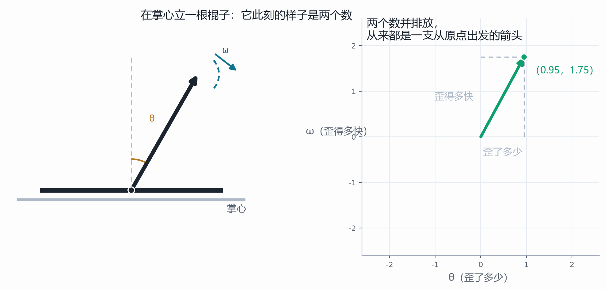

这两个数都能量。歪了多少是一个角度：从竖着那条线量起，偏过去了多少；歪得多快是每秒钟又偏了多少。手里拿一把量角器，它一次只给你一个刻度——一个数；另一个数要么上一刻量过、要么下一回再量，反正不在这一次的刻度里。这件事先记着。

为什么正好两个，不是一个、也不是三个？一个不够：光知道歪了多少，两根棍子可以一根刚偏过去、一根已经偏过去又往回走了；光知道歪得多快，两根棍子可以一根偏左、一根偏右。这两个数谁也推不出谁，谁也替不了谁，所以一个都不能少；而两个也就够了：再往下一个数（角加速度）不用记，它由这两个数算得出来——下面那张表就是干这个的。

怎么读这张表的两行？第一行管"歪了多少"怎么变：歪的多少每时每刻按角速度攒起来，所以第一行写下来是 θ 的系数 0、ω 的系数 1。第二行管"歪得多快"怎么变，这里有两股劲在拔河——一股是重力，棍子歪得越多，它往外拉得越狠，这一股写成 $a\theta$，a 就是"往外拉的劲"；棍子越长这个劲越小（a 就是重力加速度除以长度，所以越长的杆子倒得越慢），另一股是阻尼，转得越快被拖住得越厉害，写成 $-c\omega$。

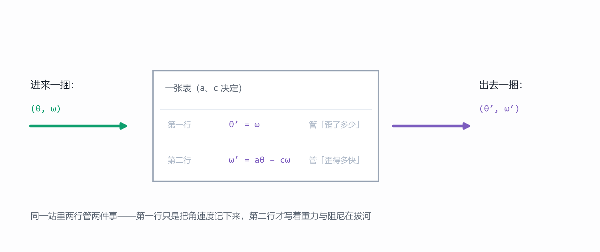

把四个数排成两行两列，就是这张表：

$$ \begin{pmatrix} \theta' \\ \omega' \end{pmatrix} = \begin{pmatrix} 0 & 1 \\ a & -c \end{pmatrix}\begin{pmatrix} \theta \\ \omega \end{pmatrix}, \qquad A = \begin{pmatrix} 0 & 1 \\ a & -c \end{pmatrix} $$

这一站的几个名字都可以后置：两个数并排叫状态，这样的式子叫状态方程，棍子加手的这整套东西工程上叫倒立摆，而这张表是把"只歪一点点"时的规律取了一次线性近似——名字先放着，值得看的是这四个数里藏着的两句话。

先看两个数。对角线加起来，是 −c；左右交叉相减，是 −a。上一篇第五、六站说过，这两个数是一张表的两条命根子：**两个特征方向的倍数加起来等于对角线之和，乘起来等于交叉相减的那个数**。写成式子就是这样：

$$ \lambda_1+\lambda_2=\operatorname{tr}A=-c,\qquad \lambda_1\lambda_2=\det A=-a,\qquad \lambda^2+c\lambda-a=0 $$

取 a ＝ 1、c ＝ 0.2 代进去，两个倍数是 +0.90 和 −1.10。一正一负。

一正一负，就是这一站的全部。上一篇说，特征方向上的作用只是把长短变一个倍数：倍数是正的，那一捆数就沿着这条线一个劲往外长；倍数是负的，它就沿着这条线一个劲往回缩。于是棍子的相平面上有两条特殊的直线——红线上，棍子每时每刻都更歪、歪得更快；青线上，它一边歪一边慢下来，自己回到竖着的位置。

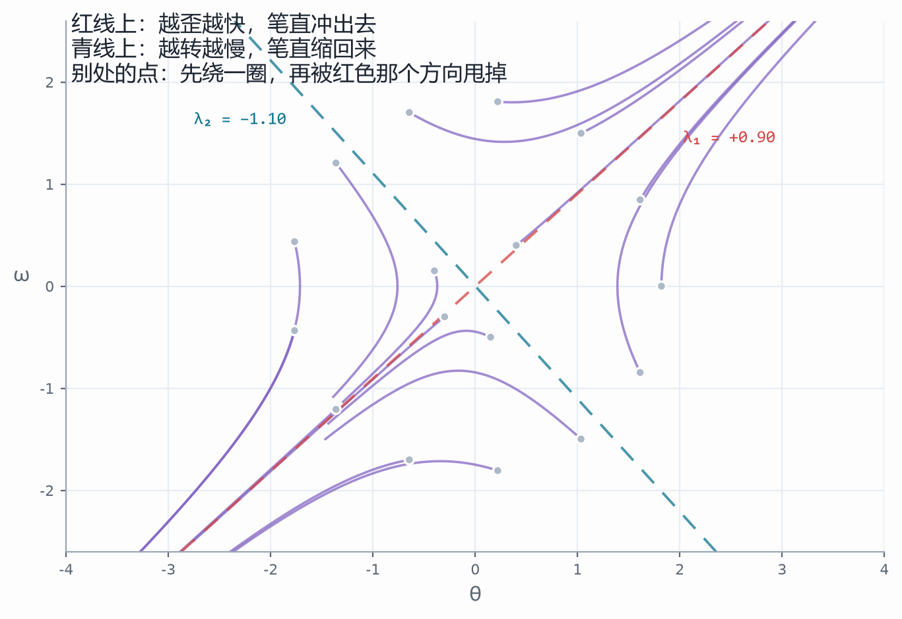

从别处出发的一捆数走的是弯线：它先绕一圈，然后被红色那个方向甩出去。只有那两条线上是直的。为什么？因为在那条线上 $Av=\lambda v$，走够 t 时间就是 $e^{\lambda t}v$，方向一刻没变，变的只是长短按 λ 这个倍数长或缩。这句话在项目里能亲手验：在红线附近放一个点，它笔直地冲出去；在青线上放一个点，它笔直地缩回来；只要离开这两条线，轨迹就弯了。

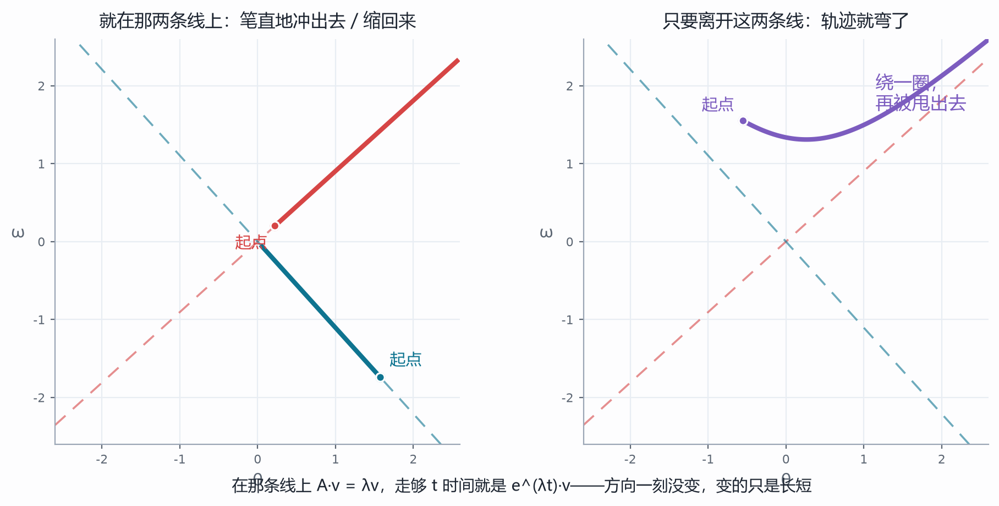

再做一次实验，这回换掉的是起点。把出发点从右上角拖到左下角、从左半边拖到右半边，轨迹一条一条全变了：有的笔直冲出去，有的先绕一圈，有的先缩一段再拐弯。可那两条直线一动没动，弯的线照样往红线上贴，直的照样在青线上缩。换一个会变的东西，看什么没跟着变——**两个倍数跟起点一点关系都没有，它只认那张表。**

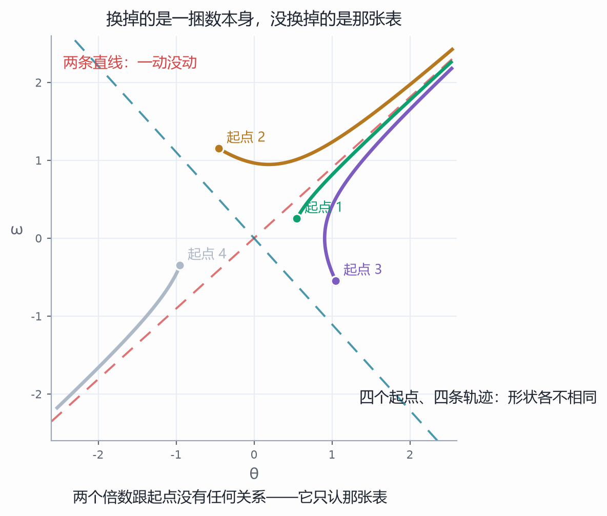

读到这儿，最容易读错的一句话是"站不住"。站不住不是"怎么动都跑掉"——青线上那一捆就自己回来了。站不住的意思是：**有一个方向跑掉，而只要有一个方向跑掉，这根棍子迟早会倒**；因为真实的一捆数里，多少总掺着一点红线的成分。一个跑、一个回来的那种点，名字叫鞍点——不用记这个名字，记住那个画面就够了。

到这一步可以动手撞那句话了：改参数。棍子换长换短是改 a，加阻尼是改 c。我们把 a 从 −2 扫到 2.5、c 从 0 扫到 3，每一格都重算一遍两个倍数，再把"最大的那个倍数"的正负涂成颜色——正的红、负的青，得到一张地图。

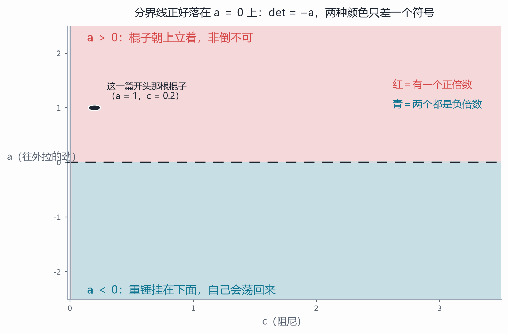

地图上有一条清清楚楚的分界：a ＝ 0。分界上面全红，下面全青。凭什么这么干净？回头看第二行左下角那个 a——它前面没有负号，所以交叉相减得到的是 −a。而交叉相减那个数等于两个倍数乘起来；乘起来是负的，就一定一正一负。再问 a 是什么：a 大于零是棍子朝上立着，a 小于零是重锤挂在下面——那是节拍器那一类东西，它自己会荡回来，也是小学就玩过的另一个玩具。同一根棍子，只差一个符号，稳不稳就换了个个儿；而阻尼这一项（对角线之和 −c）只管两个倍数的大小，管不了它们的正负。

于是再看阻尼这一列。把 c 从 0.2 一路加到 10，等于给棍子泡进越来越稠的糖浆。两个倍数变了吗？变了：正的那个从 0.90 一路掉到 0.099。可它掉到哪儿去了？掉到 0.099——还在横轴上方。

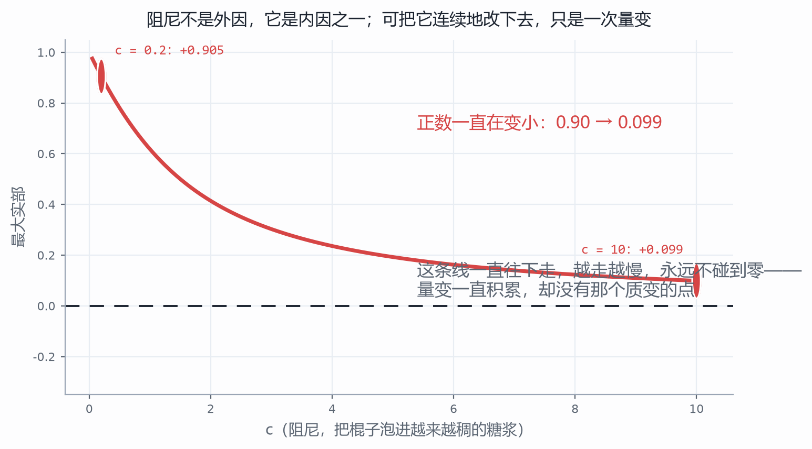

这条线一直往下走，越走越慢，永远不碰到零。阻尼不是外因，它是棍子的内因之一；可是把内因连续地改下去，得到的是一次量变——正数一直在变小，从 0.90 到 0.099。量变要积累到质变，需要一个点：正数变成负数的那一点，而这条曲线上没有这个点。

到这儿，那句话就撞断了。不是"改参数没用"，而是更硬的一句：**有的系统，内因怎么改都改不出你想要的那个性质**。变化的条件可以随便换，变化的根据说它非倒不可——矛盾就摆在这么直白的地方。

撞断了怎么办？退一步，去看手。一个人立棍子的那三秒钟里到底在做什么？他眼睛盯着棍子，看见它歪了，手就跟着往那边走，让掌心追上棍子的顶端。歪得越厉害，手走得越快；要是还在往那边歪，手就比歪的速度再快一点。注意他拿什么当原料：眼睛一次只交给他一个数——歪了多少；"歪得多快"是他自己拿两回看相减比出来的，比得粗，还带着抖。这件事他半秒钟里做了几十下，自己完全不知道在做什么数学。

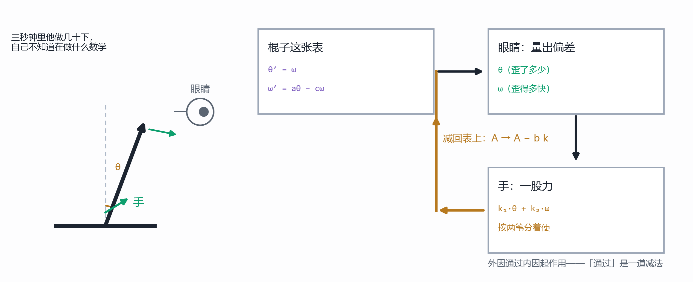

把"手跟着走"写成一条线，就又回到了上一篇的语言。手给的力作用在哪儿？作用在"歪得多快"这一行上。**力从哪儿进去**是两个数并排的一列，写下来是 b ＝ (0, 1)；手使多大劲，按"歪了多少"分一笔、按"歪得多快"分一笔，各配一个系数，写成一行 k ＝ (k₁, k₂)。这两笔合起来是一股力，力又作用回表上，于是表得改写：

$$ A_{\text{闭环}}=A-bk=\begin{pmatrix} 0 & 1 \\ a-k_1 & -c-k_2 \end{pmatrix} $$

看第二行：左下角原来那个 a 变成了 $a-k_1$，右下角原来那个 −c 变成了 $-c-k_2$。**一列乘一行，减在那张表上**——就减了这么一下，别的什么也没动。这件事可以说得更重一点：引回来的那条线是外因，而它一接上，就被吃进了那张表里，成了内因的一部分。外因通过内因起作用，在手立棍子这件事上，"通过"是一道减法；这件事工程上叫反馈，名字是后置的，因为话已经说完了。

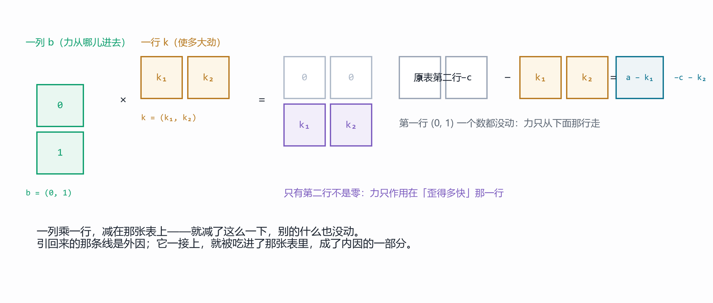

这里要多说一句为什么要这么写。b 竖着写，是因为它要跟表相乘：一张表乘一列，出来的还是一列，力才落得回一捆数上；b 要是横着写，这一乘就乘不起来。k 横着写，是因为它要乘在一捆数上得出一个数：一行乘一列，是一个数，正好是力的大小。而一列乘一行得到的是一张表——那一乘就是上面那道减法。两个方向记反了，减出来的东西会去改第一列；那正是下一篇要干的活，混了这两件事，两篇就串了。

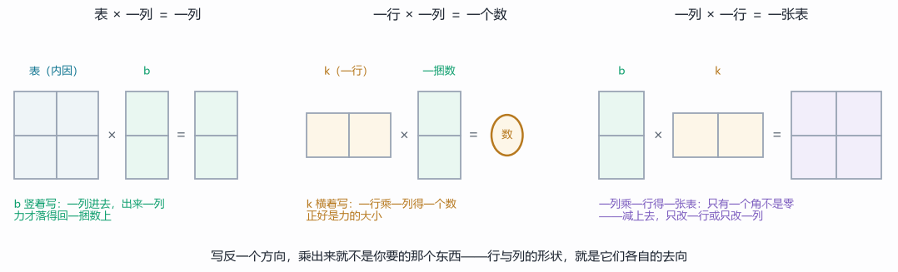

顺便把"作用"这个词的三种去向排一排，免得它读起来像个万能比喻：两个基相加，"作用的那个"在结果里没有了位置——这是理想化的代价；一张表乘一捆数，表没有消失，它变成了"每一列被送到哪儿"的那组系数；两张表相乘，作用的表并进了新表里，成了内因的一部分。这一步用的是第三种；前两种上一篇都用过，只是当时没给它们编号。

两张表要有个说法区分：原来那张叫开环表（"歪多少、歪多快"只是被报告出去看，没人理它），接线以后的叫闭环表（把它引回来，接成一个圈）。新表的两个倍数是多少？还是那两个命根子：对角线相加是 $-c-k_2$，交叉相减是 $k_1-a$。于是新表的特征方程是

$$ \lambda^2+(c+k_2)\lambda+(k_1-a)=0 $$

要它两个倍数都是负的，看两个系数就够了：$c+k_2>0$，$k_1-a>0$。

两个数说清了整件事：**k₁ 要压过 a**——手往那边走的劲得压过棍子往外倒的劲；**k₂ 要压过 −c**——按速度分的那一笔得压过阻尼。拿 a ＝ 1、c ＝ 0.2 试，取 k ＝ (3, 2.8)，两个倍数是 −1.00 与 −2.00，干净得像刻度。

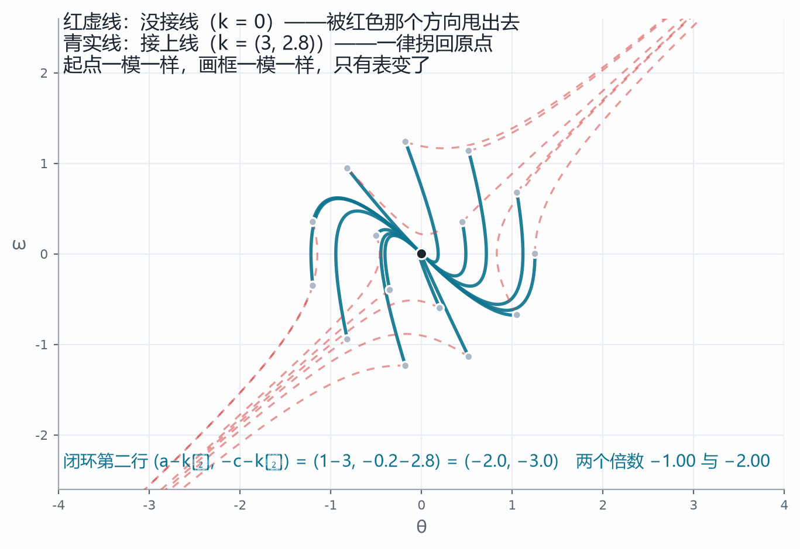

"接线"这件事本身也有意思：k 只要压过那两个数，棍子就稳；压不过，它照样跑。k₁ ＝ a 的时候，两个系数里有一个变成零，两个倍数里就有一个落在 0 上——它既不肯回来也不跑掉，就那么一直歪着。这就是"压得住"与"压不住"之间的那个点，项目里把 k₁ 拖过 a 就能当场看见它变色。

下一件事更狠：能不能不来回试，直接说"我要两个倍数落在哪儿"，然后反解出该用多大力？

能。上一篇第五站说过两个倍数是一元二次方程的两根，而两根由"和"与"积"定住。把上面那个特征方程对着 $\lambda^2-s\lambda+t$ 一比系数，力就出来了：$k_1=a+t$、$k_2=-s-c$。想要 −1 与 −2？它们的和 s ＝ −3、积 t ＝ 2，于是 k₁ ＝ 1 + 2 ＝ 3、k₂ ＝ 3 − 0.2 ＝ 2.8——和上面一模一样。

还有一条完全不通的路会给出同一个答案：不从系数出发，直接从表本身出发，把想要的方程代进表里算。两条路一条从数出发、一条从表出发，答案分毫不差，这就是互证。项目里把两条算路并排印在读数里，就是为了让人不能只信一条。把倍数搬到想去的地方这件事叫极点配置——名字同样后置。

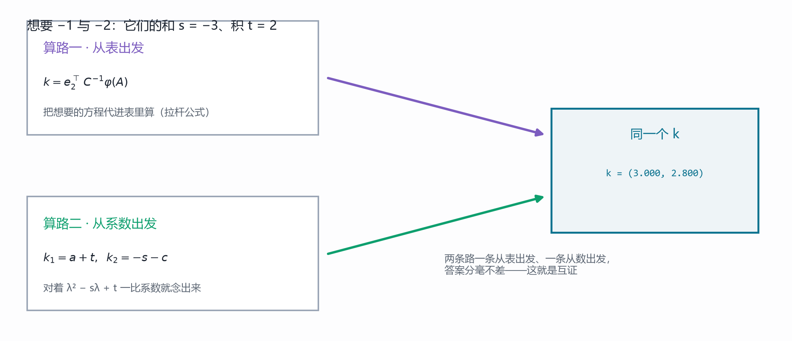

把这个"搬家"画出来，是复平面上的事：两个倍数都是复数，横轴是实部、纵轴是虚部，左半边是"自己回来"的那一半，右半边是"自己跑掉"的那一半。原来那根棍子的两个倍数是 +0.90 和 −1.10，一个在右半边、一个在左半边。你想让它们搬到哪儿，就把它拖到哪儿，项目替你把力的两笔算出来。

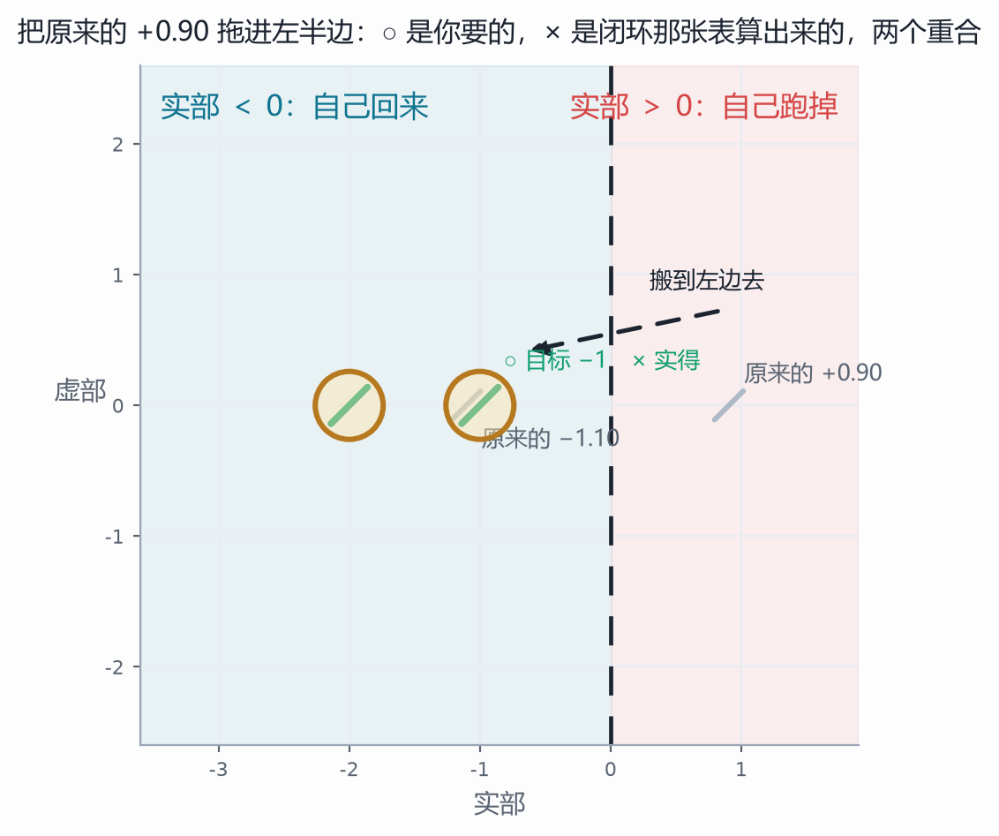

再往回问一句：能不能让它绕两圈再回来？可以。绕圈意味着一对共轭的复倍数 $\lambda_{1,2}=p\pm qi$，而共轭一对的和 $p+q$ 与积 $pq$ 仍然是实数，所以照样只需要一行实数的 k。但有一条边界得说清：复平面上的两个目标不是随便拖的。把上面那个圆往上拖一点、让它们不再共轭，项目会告诉你"这一对做不到"。为什么？看表——这张表的四个数都是实的，它的特征方程的系数就都是实的；而系数是实的方程，两个根要么是一对实数，要么是一对共轭复数。这不是力不够大，是结构上不可能。

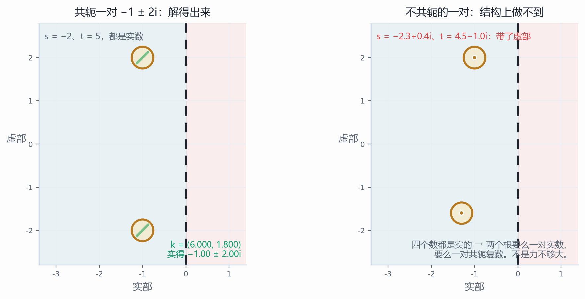

最后一站是这一篇的底。前面每一站都默认一件事：k 想使多大就使多大。可是力**从哪儿**进去，是有讲究的。

把 b 和"b 被表摁一下之后的去处 Ab"摆在一起，这两支箭头张成一个平行四边形，它的面积算得出来，就是上一篇那个交叉相减：

$$ C=\begin{pmatrix} b & Ab \end{pmatrix}, \qquad \det C=\det\begin{pmatrix} b & Ab \end{pmatrix} $$

面积不为零的时候，平面上每个方向都够得着——你说要把倍数搬到哪儿，力就解得出来。面积塌成零呢？

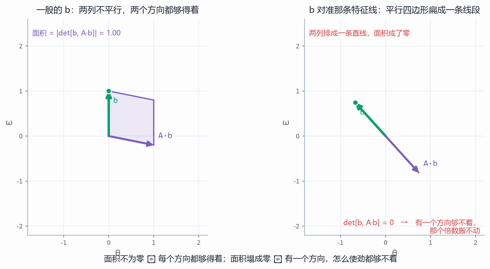

把 b 拖到那条红线或青线上去试试。因为在那条线上 Ab 与 b 同向，两支箭头排成一条直线，平行四边形扁成一条线段，面积成了零，$\det C=0$。这时候你说"我要搬到 −1 和 −2"，项目解不出力来，它返回一个空：有一个方向够不着，那个倍数搬不动。"够得着"就是能控性（名字照例后置），它的判据是"面积不为零"；换个说法是"你试遍了力气也找不到方向"和"面积是不是零"，一句话说的是同一件事的两面。稳定也是这样两种说法：「扰动会不会长大」说的是过程，「两个倍数在不在左半边」说的是判据，两面指同一件事。

但最有意思的地方在这儿：红线和青线各是一处塌缩，后果却完全不一样。

b 落在红线上（那是"自己跑掉"的方向），够不着的那个方向恰好是自己会回来的——使劲够大，另一个倍数照样搬得动，棍子还救得回来。b 落在青线上（那是"自己回来"的方向），够不着的那个方向恰好是那个跑掉的——使劲一百倍、一千倍也没用，它还是 +0.90。同一处退化、同一个面积为零，一个还有救、一个没救，差别只在够不着的那个方向，它自己本来是正的还是负的。

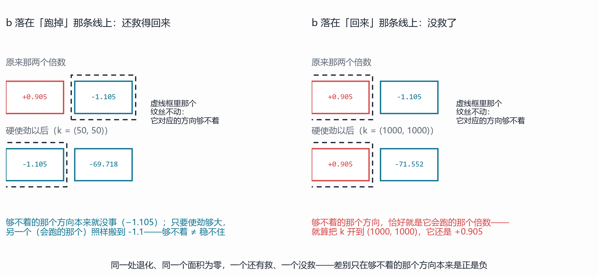

还有一条边界要说。稍微偏一点点、让两支箭头不再严格排齐，面积就从 0 变成一个小小的正数，立刻又能控了。可代价呢：面积 0.04 的时候，要的力是一百三十几；面积缩到 0.002、小了二十倍，要的力涨到两千七百多——也正好大二十倍，因为 $\lVert k\rVert$ 与 $\det C$ 成反比。面积越接近零，答案越大，"够得着"与"好使唤"是两回事：判据只回答有没有解，不回答解出来多大。越靠近那处塌缩，答案越像对着空谷喊出来的。

到这里该收尾了。上一篇教的动作是"改内因参数"，这一篇把这个动作撞了一下，撞出来三个动作。

第一个还是改内因：改结构、改参数（棍子长短、阻尼）。这一篇证明的是，光有这个不够——有一个正倍数压在那儿，怎么改都压不掉。

第二个是动外因：换一捆数进去。可对一个非倒不可的系统，换一捆数进去只是换了一个倒法。

第三个才是新的：**让外因改造内因**。引一条线回来，把"歪了多少、歪得多快"变成一行力，这条线一接上，那张表就换了。表是内因，力是外因；外因不是从旁边推了它一把，是把自己写进了内因里。这才是外因通过内因起作用最实的一层意思：不是外因隔着一层去敲内因，而是外因被内因吸收之后，内因就不再是原来那个内因了。

这三件事说完了，还得说一句它说不出什么。这一篇的力是"有人替你算好、替你使出来"的：它说得清该用多大的 k，说不出那只手凭什么知道该往哪儿补——它手里只有一个数（歪了多少），"歪得多快"是自己拿两回看相减比出来的。这一比有多不准、噪声有多大、能不能比得更好，这一篇一个字也没碰。

而这条线能不能接上、接上之后能不能把倍数搬到想去的地方，先得问一个更靠前的问题：力从哪儿进去？那就是最后那张平行四边形。它塌下去的时候，无论你怎么使劲，都有一个方向够不着。

带走三问，接着上一篇的三问往下走。上一篇的三问问内因（表是什么、哪些方向变了又没变、面积放大还是摁扁）；这一篇的三问接着往前一步：**它接下来是回来还是跑掉？**——看两个倍数的正负，一句话就说清了。**它跑掉的那个方向，我够得着吗？**——看 b 与 Ab 张成的面积塌没塌。**够得着的话，我要它落在哪儿？**——反解出力，把倍数搬进左半边。三问问完，一个系统的内外因都摸到了，还摸到了它们之间那道减法。

深水区照例挖坑，留给番外篇：两个倍数为什么"加起来是对角线之和、乘起来是交叉相减"（求根公式摆在这儿，证明留到下一篇）；k 里那两个系数到底代表多大的力、和电机的力矩怎么换算——这是从数学走进车间的那一步；n 个状态、m 个输入怎么写（b 变成一列一列的 B，k 变成一行一行的 K，够不够得着要看一整张矩阵的秩）；还有那个"够得着但很费力"的地方，接近塌缩时解出来的力会爆掉，工程上怎么绕开它，那是数值与鲁棒性的正场；以及最要紧的一个坑——这一篇从头到尾用的都是"只歪一点点"时的那张近似表，可棍子真歪到三十度，那四个数就不够用了。非线性是另一篇文章的事，我们迟早要回去找它。

这一篇的图与可交互的部分是配套项目，在本目录的"控制项目"文件夹里，双击即可打开，全部离线。五个视角——站不住的点、内因改不动、把线接回来、把倍数搬家、搬不动的时候——每一站都能改条件、看后果，右侧都写着互证与反例；正文里每一张图，都是从项目的同一套数学里算出来的。读到哪儿手痒，就去把那个滑条拉到那儿：把阻尼推到 10，看那个正数还在不在；把 k₁ 拖到 a 以下，看判词当场变色；把 b 拖到那条特征线上，看平行四边形怎么扁成一条线段。内因终究是变化的根据，而这一篇里，读者自己上手的那几下，就是外因挤进内因的那道缝。
